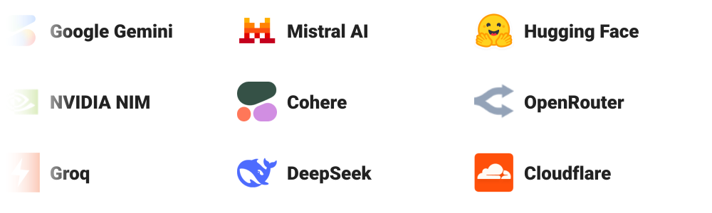

<p align="center">
  <h1 align="center">awesome-free-llm-apis</h1>
  <!-- AUTO_STATS -->
  <p align="center"><strong>22개 제공업체, 309+개의 무료 LLM API</strong> — 무료 모델을 검색, 비교, 설정하세요.</p>
<!-- END_AUTO_STATS -->
</p>

<p align="center">
  <a href="https://freellm.net" target="_blank" rel="noopener"><strong>🌐 freellm.net 방문</strong></a> —
  <a href="https://freellm.net/models/" target="_blank" rel="noopener">모델 찾기</a> ·
  <a href="https://freellm.net/playground/" target="_blank" rel="noopener">플레이그라운드</a> ·
  <a href="https://freellm.net/config/" target="_blank" rel="noopener">설정 생성</a> ·
  <a href="https://freellm.net/free-llm-api-keys/" target="_blank" rel="noopener">API 키</a>
</p>

<p align="center">
  
</p>

  <!-- AUTO_UPDATE_BADGE -->
  <p align="center"><strong>🔄 <a href="https://freellm.net" target="_blank" rel="noopener">freellm.net</a>에서 자동 동기화</strong> — 카탈로그 데이터 업데이트: 2026-11-22 · README 생성: 2026-11-22 · <a href="./STATUS.md">🟢 서비스 상태 (STATUS.md)</a> · <a href="https://freellm.net/free-llm-api-status" target="_blank" rel="noopener">실시간 대시보드 →</a></p>
<!-- END_AUTO_UPDATE_BADGE -->

<p align="center">
  🌐 <a href="README.md">English</a> · <a href="README.zh-CN.md">简体中文</a> · <a href="README.zh-TW.md">繁體中文</a> · <a href="README.ja.md">日本語</a> · <a href="README.ko.md">한국어</a>
</p>

---

## 이 프로젝트가 필요한 이유

무료 LLM API를 찾기 위해 여러 GitHub README를 뒤지고, 여러 플랫폼에 가입하고, 어떤 모델이 아직 무료 티어를 제공하는지 추측해서는 안 됩니다.

이 저장소는 **구조화된 기계 판독 가능 무료 LLM API 디렉토리**입니다 — 속도 제한, 컨텍스트 윈도우, 원클릭 설정 스니펫, API 키 링크를 매일 업데이트합니다.

**이 저장소 + <a href="https://freellm.net" target="_blank" rel="noopener">freellm.net</a>을 선택하는 이유:**

- ✅ **항상 최신** — 매일 자동 모니터링으로 업데이트, 2년 된 정적 목록이 아닙니다
- ✅ **신용카드 투명성** — 신용카드 필요, 전화 인증 필요, 완전 무료 제공업체를 명확히 표시
- ✅ **원클릭 설정** — Claude Code, Cursor, Codex, Aider 등 10개 이상 도구 지원
- ✅ **나란히 비교** — 컨텍스트 윈도우, 속도 제한, 멀티모달 지원을 즉시 비교

---

## 3단계로 시작하기

1. **제공업체 선택** — 아래 [Provider Directory](#provider-directory)를 보세요. **Groq**부터 시작하는 것을 추천（신용카드 불필요, 30 RPM 무료).
2. **API 키 발급** — 아래 [Quick Reference](#quick-reference--base-urls--api-keys)의 [Get Key →] 링크를 클릭해서 가입（대부분 이메일만 필요), 키를 복사. 1분도 안 걸립니다.
3. **코드에 붙여넣기** — base URL + model ID를 복사해서 아래 [빠른 시작](#빠른-시작--30초-만에-무료-api-사용하기) 예제에 붙여넣으세요.

도구 설정이 필요하세요? <a href="https://freellm.net/config/#claude-code" target="_blank" rel="noopener">Claude Code</a> · <a href="https://freellm.net/config/#cursor" target="_blank" rel="noopener">Cursor</a> · <a href="https://freellm.net/config/#codex" target="_blank" rel="noopener">Codex</a> · <a href="https://freellm.net/config/#openhuman" target="_blank" rel="noopener">OpenHuman</a> · <a href="https://freellm.net/config/#opencode" target="_blank" rel="noopener">OpenCode</a> · <a href="https://freellm.net/config/#openclaw" target="_blank" rel="noopener">OpenClaw</a> — <a href="https://freellm.net/config/" target="_blank" rel="noopener">freellm.net/config/</a>에서 원클릭 설정.


## 빠른 시작 — 30초 만에 무료 API 사용하기

**API를 처음 써보세요?** 가장 간단한 방법: <a href="https://console.groq.com/keys" target="_blank" rel="noopener">console.groq.com/keys</a>에 접속, 이메일만으로 가입（신용카드 불필요), 무료 키를 복사해서 아래 예제에 붙여넣으세요. 1분도 안 걸려 실행할 수 있습니다.

아래 모든 제공업체는 **OpenAI 호환 엔드포인트**를 제공합니다. `baseURL` + `apiKey`를 지원하는 모든 도구에서 작동합니다 — base URL과 키만 바꾸면 됩니다.

### Python (OpenAI SDK)

```python
from openai import OpenAI

client = OpenAI(
    base_url="https://api.groq.com/openai/v1",  # 무료, 신용카드 불필요
    api_key="GROQ_API_KEY",                     # 발급: console.groq.com/keys
)

response = client.chat.completions.create(
    model="llama-3.3-70b-versatile",            # 모델 목록은 아래 Best Models 표 참조
    messages=[{"role": "user", "content": "안녕하세요!"}],
)
print(response.choices[0].message.content)
# Groq 무료 한도: 30 RPM, 14,400 RPD — 개인 사용에 충분
```

### Codex CLI

```bash
export OPENAI_BASE_URL="https://api.groq.com/openai/v1"
export OPENAI_API_KEY="your-groq-key"          # 발급: console.groq.com/keys
codex --model "llama-3.3-70b-versatile"
```

### Cursor

```
Settings → Models → Add Model
  Model name: llama-3.3-70b-versatile
  Base URL: https://api.groq.com/openai/v1
  API key: your-groq-key                       # 발급: console.groq.com/keys
```

### Claude Code

```bash
# Claude Code 는 Anthropic 호환 API 필요 — OpenRouter 사용
export ANTHROPIC_BASE_URL="https://openrouter.ai/api"
export ANTHROPIC_AUTH_TOKEN="sk-or-v1-your-key"  # openrouter.ai/keys
export ANTHROPIC_API_KEY=""                       # 빈 값 필수
# 참고: OpenRouter Anthropic 모델은 $10 충전 필요 (1회)
```

### 다른 도구 사용하기

대부분의 AI 개발 도구는 커스텀 API 엔드포인트를 지원합니다. 무료 키를 받은 후:

- **Claude Code** — `ANTHROPIC_BASE_URL` + `ANTHROPIC_AUTH_TOKEN` 설정.<a href="https://freellm.net/config/#claude-code" target="_blank" rel="noopener">단계별 가이드 →</a>
- **Cursor** — Settings → Models → Add Model.<a href="https://freellm.net/config/#cursor" target="_blank" rel="noopener">단계별 가이드 →</a>
- **Codex CLI** — `OPENAI_BASE_URL` + `OPENAI_API_KEY` 설정.<a href="https://freellm.net/config/#codex" target="_blank" rel="noopener">단계별 가이드 →</a>
- **OpenHuman** — `config.toml` 편집.<a href="https://freellm.net/config/#openhuman" target="_blank" rel="noopener">단계별 가이드 →</a>
- **Aider** — `.aider.conf.yml` 편집.<a href="https://freellm.net/config/#aider" target="_blank" rel="noopener">단계별 가이드 →</a>
- **Cline**（VS Code）— API provider 설정.<a href="https://freellm.net/config/#cline" target="_blank" rel="noopener">단계별 가이드 →</a>
- **Open WebUI** — Settings → Connections.<a href="https://freellm.net/config/#open-webui" target="_blank" rel="noopener">단계별 가이드 →</a>

더 많은 즉시 사용 가능한 설정은 **<a href="https://freellm.net/config/" target="_blank" rel="noopener">freellm.net/config/</a>** 에서.

> **모든 제공업체의 Base URL 및 API 키 링크**는 아래 [Quick Reference](#quick-reference--base-urls--api-keys) 참조.


---

## 제공업체 디렉토리 & 인기 무료 모델

<!-- BEGIN_PERMANENT_FREE -->
| Provider | Free Models | Credit Card? | Max Context | Modalities | Get API Key |
|---|---|---|---|---|---|
| NVIDIA NIM | 82 | Phone verification | 1M | Multimodal | <a href="https://build.nvidia.com/settings/api-keys" target="_blank" rel="noopener">→</a> |
| Cloudflare Workers AI | 41 | No | 262K | Multimodal | <a href="https://dash.cloudflare.com/profile/api-tokens" target="_blank" rel="noopener">→</a> |
| ModelScope | 33 | Registration | 1M | Vision, Reasoning | <a href="https://modelscope.cn/my/myaccesstoken" target="_blank" rel="noopener">→</a> |
| OpenCode Zen | 22 | Registration | 1M | Vision, Reasoning | <a href="https://opencode.ai/auth" target="_blank" rel="noopener">→</a> |
| Kilo Code | 18 | No | 1M | Multimodal | <a href="https://app.kilo.ai/profile" target="_blank" rel="noopener">→</a> |
| Google Gemini | 12 | No | 1M | Multimodal | <a href="https://aistudio.google.com/app/apikey" target="_blank" rel="noopener">→</a> |
| LLM7.io | 11 | No | 1M | Multimodal | <a href="https://token.llm7.io" target="_blank" rel="noopener">→</a> |
| Mistral AI | 10 | No | 256K | Multimodal | <a href="https://console.mistral.ai/api-keys" target="_blank" rel="noopener">→</a> |
| Cohere | 10 | No | 256K | Text, Vision | <a href="https://dashboard.cohere.com/api-keys" target="_blank" rel="noopener">→</a> |
| OVHcloud AI Endpoints | 8 | No | 262K | Multimodal | <a href="https://www.ovhcloud.com/en/public-cloud/ai-endpoints/catalog/" target="_blank" rel="noopener">→</a> |
| Ollama Cloud | 8 | No | 1M | Multimodal | <a href="https://ollama.com/settings/keys" target="_blank" rel="noopener">→</a> |
| Agnes AI | 6 | No | 256K | Multimodal | <a href="https://platform.agnes-ai.com/settings/apiKeys" target="_blank" rel="noopener">→</a> |
| Groq | 6 | No | 131K | Multimodal | <a href="https://console.groq.com/keys" target="_blank" rel="noopener">→</a> |
| Aion Labs | 4 | No | 128K | Text, Reasoning | <a href="https://www.aionlabs.ai/app/api-keys/" target="_blank" rel="noopener">→</a> |
| Gonka Broker | 4 | No | 400K | Multimodal | <a href="https://app.gonkabroker.com/signup" target="_blank" rel="noopener">→</a> |
| Z AI (Zhipu AI) | 4 | No | 200K | Multimodal | <a href="https://open.bigmodel.cn/usercenter/apikeys" target="_blank" rel="noopener">→</a> |
| Chutes.ai | 2 | No | 131K | Text, Reasoning | <a href="https://chutes.ai/" target="_blank" rel="noopener">→</a> |
| Glhf.chat | 2 | No | 131K | Text | <a href="https://glhf.chat/" target="_blank" rel="noopener">→</a> |
| Grok (xAI) | 2 | Registration | 131K | Text | <a href="https://console.x.ai/" target="_blank" rel="noopener">→</a> |
| SiliconFlow | 2 | No | 0 | Text | <a href="https://cloud.siliconflow.cn/account/ak" target="_blank" rel="noopener">→</a> |
| Cline | 2 | Registration | 0 | Text, Vision | - |
<!-- END_PERMANENT_FREE -->

<!-- BEGIN_RENEWABLE -->
| Provider | Free Models | Credit Model | Max Context | Modalities | Get API Key |
|---|---|---|---|---|---|
| OpenRouter | 20 | Free tier + $10 topup → 1K RPD | 1M | Multimodal | <a href="https://openrouter.ai/workspaces/default/keys" target="_blank" rel="noopener">→</a> |
<!-- END_RENEWABLE -->

## 빠른 참조 — Base URL 및 API 키

<!-- BEGIN_QUICK_REF -->
| Provider | Base URL | Get API Key | Credit Card? |
|---|---|---|---|
| NVIDIA NIM | `https://integrate.api.nvidia.com/v1` | <a href="https://build.nvidia.com/settings/api-keys" target="_blank" rel="noopener">Get Key →</a> | Phone verification |
| Cloudflare Workers AI | `https://api.cloudflare.com/client/v4/accounts/{account_id}/ai/run` | <a href="https://dash.cloudflare.com/profile/api-tokens" target="_blank" rel="noopener">Get Key →</a> | No |
| ModelScope | `https://api-inference.modelscope.cn/v1` | <a href="https://modelscope.cn/my/myaccesstoken" target="_blank" rel="noopener">Get Key →</a> | Registration |
| OpenCode Zen | `https://opencode.ai/zen/v1` | <a href="https://opencode.ai/auth" target="_blank" rel="noopener">Get Key →</a> | Registration |
| OpenRouter | `https://openrouter.ai/api/v1` | <a href="https://openrouter.ai/workspaces/default/keys" target="_blank" rel="noopener">Get Key →</a> | No |
| Kilo Code | `https://api.kilo.ai/api/gateway` | <a href="https://app.kilo.ai/profile" target="_blank" rel="noopener">Get Key →</a> | No |
| Google Gemini | `https://generativelanguage.googleapis.com/v1beta` | <a href="https://aistudio.google.com/app/apikey" target="_blank" rel="noopener">Get Key →</a> | No |
| LLM7.io | `https://api.llm7.io/v1` | <a href="https://token.llm7.io" target="_blank" rel="noopener">Get Key →</a> | No |
| Mistral AI | `https://api.mistral.ai/v1` | <a href="https://console.mistral.ai/api-keys" target="_blank" rel="noopener">Get Key →</a> | No |
| Cohere | `https://api.cohere.com/v2` | <a href="https://dashboard.cohere.com/api-keys" target="_blank" rel="noopener">Get Key →</a> | No |
| OVHcloud AI Endpoints | `https://oai.endpoints.kepler.ai.cloud.ovh.net/v1` | <a href="https://www.ovhcloud.com/en/public-cloud/ai-endpoints/catalog/" target="_blank" rel="noopener">Get Key →</a> | No |
| Ollama Cloud | `https://ollama.com/v1` | <a href="https://ollama.com/settings/keys" target="_blank" rel="noopener">Get Key →</a> | No |
| Agnes AI | `https://apihub.agnes-ai.com/v1` | <a href="https://platform.agnes-ai.com/settings/apiKeys" target="_blank" rel="noopener">Get Key →</a> | No |
| Groq | `https://api.groq.com/openai/v1` | <a href="https://console.groq.com/keys" target="_blank" rel="noopener">Get Key →</a> | No |
| Aion Labs | `https://api.aionlabs.ai/v1` | <a href="https://www.aionlabs.ai/app/api-keys/" target="_blank" rel="noopener">Get Key →</a> | No |
| Gonka Broker | `https://proxy.gonkabroker.com/v1` | <a href="https://app.gonkabroker.com/signup" target="_blank" rel="noopener">Get Key →</a> | No |
| Z AI (Zhipu AI) | `https://open.bigmodel.cn/api/paas/v4` | <a href="https://open.bigmodel.cn/usercenter/apikeys" target="_blank" rel="noopener">Get Key →</a> | No |
| Chutes.ai | `https://api.chutes.ai/v1` | <a href="https://chutes.ai/" target="_blank" rel="noopener">Get Key →</a> | No |
| Glhf.chat | `https://glhf.chat/api/openai/v1` | <a href="https://glhf.chat/" target="_blank" rel="noopener">Get Key →</a> | No |
| Grok (xAI) | `https://api.x.ai/v1` | <a href="https://console.x.ai/" target="_blank" rel="noopener">Get Key →</a> | Registration |
| SiliconFlow | `https://api.siliconflow.cn/v1` | <a href="https://cloud.siliconflow.cn/account/ak" target="_blank" rel="noopener">Get Key →</a> | No |
| Cline | - | - | Registration |
<!-- END_QUICK_REF -->

## 제공업체별 최고의 무료 모델

<!-- BEGIN_BEST_MODELS -->
| Provider | Best Free Model | Model ID | Max Context | Rate Limit |
|---|---|---|---|---|
| NVIDIA NIM | <a href="https://freellm.net/models/nvidia-nim/z-ai-glm-5-3-flash/" target="_blank" rel="noopener">z-ai/glm-5.3-flash</a> | `z-ai/glm-5.3-flash` | 1M | Up to 40 RPM |
|  | <a href="https://freellm.net/models/nvidia-nim/poolside-laguna-xs-2-1/" target="_blank" rel="noopener">poolside/laguna-xs-2.1</a> | `poolside/laguna-xs-2.1` | 262K | Up to 40 RPM |
|  | <a href="https://freellm.net/models/nvidia-nim/moonshotai-kimi-k2-6/" target="_blank" rel="noopener">moonshotai/kimi-k2.6</a> | `moonshotai/kimi-k2.6` | 262K | Up to 40 RPM |
| Cloudflare Workers AI | <a href="https://freellm.net/models/cloudflare-workers-ai/%40cf%2Fthinkingmachines%2Finkling-2-small/" target="_blank" rel="noopener">@cf/thinkingmachines/inkling-2-small</a> | `@cf/thinkingmachines/inkling-2-small` | 8K | - |
|  | <a href="https://freellm.net/models/cloudflare-workers-ai/%40cf%2Fzai-org%2Fglm-5.3/" target="_blank" rel="noopener">@cf/zai-org/glm-5.3</a> | `@cf/zai-org/glm-5.3` | 8K | - |
|  | <a href="https://freellm.net/models/cloudflare-workers-ai/%40cf%2Fzai-org%2Fglm-5.3-flash/" target="_blank" rel="noopener">@cf/zai-org/glm-5.3-flash</a> | `@cf/zai-org/glm-5.3-flash` | 8K | - |
| ModelScope | <a href="https://freellm.net/models/modelscope/deepseek-ai%2FDeepSeek-V4.1-Flash/" target="_blank" rel="noopener">deepseek-ai/DeepSeek-V4.1-Flash</a> | `deepseek-ai/DeepSeek-V4.1-Flash` | 8K | - |
|  | <a href="https://freellm.net/models/modelscope/nex-agi%2FNex-N2.5-mini/" target="_blank" rel="noopener">nex-agi/Nex-N2.5-mini</a> | `nex-agi/Nex-N2.5-mini` | 8K | - |
|  | <a href="https://freellm.net/models/modelscope/nex-agi%2FNex-N2.5-Pro/" target="_blank" rel="noopener">nex-agi/Nex-N2.5-Pro</a> | `nex-agi/Nex-N2.5-Pro` | 8K | - |
| OpenCode Zen | <a href="https://freellm.net/models/opencode/mistral-large-4/" target="_blank" rel="noopener">Mistral Large 4</a> | `mistral-large-4` | 1M | - |
|  | <a href="https://freellm.net/models/opencode/deepseek-v4.1-flash/" target="_blank" rel="noopener">DeepSeek V4.1 Flash</a> | `deepseek-v4.1-flash` | 1M | - |
|  | <a href="https://freellm.net/models/opencode/space-bunny-free/" target="_blank" rel="noopener">space-bunny-free</a> | `space-bunny-free` | 8K | - |
| OpenRouter | <a href="https://freellm.net/models/openrouter/stealth-crouton-alpha/" target="_blank" rel="noopener">Crouton Alpha</a> | `stealth/crouton-alpha` | 1M | See provider |
|  | <a href="https://freellm.net/models/openrouter/nvidia-nemotron-3-ultra-550b-a55b/" target="_blank" rel="noopener">NVIDIA: Nemotron 3 Ultra (free)</a> | `nvidia/nemotron-3-ultra-550b-a55b:free` | 1M | See provider |
|  | <a href="https://freellm.net/models/openrouter/baidu-ernie-5.5-flash-preview/" target="_blank" rel="noopener">Baidu: ERNIE-5.5-Flash-Preview (free)</a> | `baidu/ernie-5.5-flash-preview:free` | 1M | See provider |
| Kilo Code | <a href="https://freellm.net/models/kilo-code/cohere-north-mini-code-free/" target="_blank" rel="noopener">cohere/north-mini-code:free</a> | `cohere-north-mini-code-free` | 256K | 200 req/hr |
|  | <a href="https://freellm.net/models/kilo-code/dots-studio-dots-3-note-preview-free/" target="_blank" rel="noopener">dots-studio/dots-3-note-preview:free</a> | `dots-studio-dots-3-note-preview-free` | 512K | 200 req/hr |
|  | <a href="https://freellm.net/models/kilo-code/recursive-flint-v1-0-free/" target="_blank" rel="noopener">recursive/flint-v1.0:free</a> | `recursive/flint-v1.0:free` | 262K | 200 req/hr |
| Google Gemini | <a href="https://freellm.net/models/google-gemini/gemini-4-hydrogen/" target="_blank" rel="noopener">Gemini 4 Hydrogen</a> | `gemini-4-hydrogen` | 1M | Varies by model and acc.. |
|  | <a href="https://freellm.net/models/google-gemini/gemini-3-8-flash/" target="_blank" rel="noopener">Gemini 3.8 Flash</a> | `gemini-3.8-flash` | 1M | - |
|  | <a href="https://freellm.net/models/google-gemini/gemini-3-7-flash/" target="_blank" rel="noopener">Gemini 3.7 Flash</a> | `gemini-3.7-flash` | 1M | - |
| LLM7.io | <a href="https://freellm.net/models/llm7-io/GLM-5.3-Flash/" target="_blank" rel="noopener">GLM-5.3-Flash</a> | `glm-5.3-flash` | 1M | - |
|  | <a href="https://freellm.net/models/llm7-io/deepseek-v4-pro/" target="_blank" rel="noopener">DeepSeek V4 Pro</a> | `deepseek-v4-pro` | 1M | - |
|  | <a href="https://freellm.net/models/llm7-io/deepseek-v4-flash-0731/" target="_blank" rel="noopener">DeepSeek-V4-Flash-0731</a> | `DeepSeek-V4-Flash-0731` | 400K | 60 RPM, 250 req/hr |
| Mistral AI | <a href="https://freellm.net/models/mistral-ai/codestral/" target="_blank" rel="noopener">Codestral</a> | `codestral` | 128K | ~1 RPS, 500K TPM |
|  | <a href="https://freellm.net/models/mistral-ai/mistral-medium-3-5-128b/" target="_blank" rel="noopener">Mistral Medium 3.5 (128B)</a> | `mistral-medium-3-5-128b` | 256K | ~1 RPS, 500K TPM |
|  | <a href="https://freellm.net/models/mistral-ai/mistral-small-4/" target="_blank" rel="noopener">Mistral Small 4</a> | `mistral-small-4` | 256K | ~1 RPS, 500K TPM |
| Cohere | <a href="https://freellm.net/models/cohere/command-r7b-arabic/" target="_blank" rel="noopener">Command R7B Arabic</a> | `command-r7b-arabic` | 128K | 20 RPM |
|  | <a href="https://freellm.net/models/cohere/command-r/" target="_blank" rel="noopener">Command R+</a> | `command-r` | 128K | 20 RPM |
|  | <a href="https://freellm.net/models/cohere/command-r7b/" target="_blank" rel="noopener">Command R7B</a> | `command-r7b` | 128K | 20 RPM |
| OVHcloud AI Endpoints | <a href="https://freellm.net/models/ovhcloud-ai-endpoints/qwen3-8-27b/" target="_blank" rel="noopener">Qwen3.8-27B</a> | `qwen3.8-27b` | 262K | 2 RPM (anonymous) |
|  | <a href="https://freellm.net/models/ovhcloud-ai-endpoints/qwen3-6-27b/" target="_blank" rel="noopener">Qwen3.6-27B</a> | `qwen3.6-27b` | 262K | 2 RPM (anonymous) |
|  | <a href="https://freellm.net/models/ovhcloud-ai-endpoints/qwen3-5-9b/" target="_blank" rel="noopener">Qwen3.5-9B</a> | `qwen3.5-9b` | 262K | 2 RPM (anonymous) |
| Ollama Cloud | <a href="https://freellm.net/models/ollama-cloud/deepseek-v4-pro/" target="_blank" rel="noopener">deepseek-v4-pro</a> | `deepseek-v4-pro:0813` | 1M | Session/weekly limits |
|  | <a href="https://freellm.net/models/ollama-cloud/nemotron-3-ultra/" target="_blank" rel="noopener">nemotron-3-ultra</a> | `nemotron-3-ultra` | 256K | 1 concurrent request, m.. |
|  | <a href="https://freellm.net/models/ollama-cloud/minimax-m3/" target="_blank" rel="noopener">minimax-m3</a> | `minimax-m3` | 512K | Session/weekly limits |
| Agnes AI | <a href="https://freellm.net/models/agnes-ai/agnes-video-2.5-flash/" target="_blank" rel="noopener">agnes-video-2.5-flash</a> | `agnes-video-2.5-flash` | 4K | 2 RPM |
|  | <a href="https://freellm.net/models/agnes-ai/agnes-3.0-flash/" target="_blank" rel="noopener">agnes-3.0-flash</a> | `agnes-3.0-flash` | 256K | Dynamic (30 RPM) |
|  | <a href="https://freellm.net/models/agnes-ai/agnes-2.5-flash/" target="_blank" rel="noopener">agnes-2.5-flash</a> | `agnes-2.5-flash` | 256K | Dynamic (30 RPM) |
| Groq | <a href="https://freellm.net/models/groq/meta-llama%2Fllama-prompt-guard-2-22m/" target="_blank" rel="noopener">meta-llama/llama-prompt-guard-2-22m</a> | `meta-llama/llama-prompt-guard-2-22m` | 8K | - |
|  | <a href="https://freellm.net/models/groq/meta-llama%2Fllama-prompt-guard-2-86m/" target="_blank" rel="noopener">meta-llama/llama-prompt-guard-2-86m</a> | `meta-llama/llama-prompt-guard-2-86m` | 8K | - |
|  | <a href="https://freellm.net/models/groq/qwen-qwen3-8-27b/" target="_blank" rel="noopener">qwen/qwen3.8-27b</a> | `qwen/qwen3.8-27b` | 131K | 30 RPM, 1,000 RPD, 8,00.. |
| Aion Labs | <a href="https://freellm.net/models/aion-labs/aion-labs-aion-3-0-mini/" target="_blank" rel="noopener">aion-labs/aion-3.0-mini</a> | `aion-labs-aion-3-0-mini` | 128K | 15 RPM, 20K TPD |
|  | <a href="https://freellm.net/models/aion-labs/aion-labs-aion-3-0/" target="_blank" rel="noopener">aion-labs/aion-3.0</a> | `aion-labs-aion-3-0` | 128K | 15 RPM, 20K TPD |
|  | <a href="https://freellm.net/models/aion-labs/aion-labs-aion-2-0/" target="_blank" rel="noopener">aion-labs/aion-2.0</a> | `aion-labs-aion-2-0` | 128K | 15 RPM, 20K TPD |
| Gonka Broker | <a href="https://freellm.net/models/gonka-broker/zai-org-glm-5-3-flash/" target="_blank" rel="noopener">zai-org/GLM-5.3-Flash</a> | `zai-org-glm-5-3-flash` | 400K | ~1M tokens/mo |
|  | <a href="https://freellm.net/models/gonka-broker/deepseek-ai-deepseek-v4-flash-0731/" target="_blank" rel="noopener">deepseek-ai/DeepSeek-V4-Flash-0731</a> | `deepseek-ai-deepseek-v4-flash-0731` | 400K | ~1M tokens/mo |
|  | <a href="https://freellm.net/models/gonka-broker/minimaxai-minimax-m2-7/" target="_blank" rel="noopener">MiniMaxAI/MiniMax-M2.7</a> | `minimaxai-minimax-m2-7` | 200K | ~1M tokens/mo |
| Z AI (Zhipu AI) | <a href="https://freellm.net/models/z-ai-zhipu-ai/glm-4-7-flash/" target="_blank" rel="noopener">GLM-4.7-Flash</a> | `glm-4.7` | 200K | 1 concurrent request |
|  | <a href="https://freellm.net/models/z-ai-zhipu-ai/glm-4-6v-flash/" target="_blank" rel="noopener">GLM-4.6V-Flash</a> | `glm-4.6` | 128K | 1 concurrent request |
|  | <a href="https://freellm.net/models/z-ai-zhipu-ai/glm-4-5-air/" target="_blank" rel="noopener">GLM-4.5-Air</a> | `glm-4.5-air` | 131K | - |
| Chutes.ai | <a href="https://freellm.net/models/chutes-ai/deepseek-ai-deepseek-r1/" target="_blank" rel="noopener">DeepSeek-R1</a> | `deepseek-ai/DeepSeek-R1` | 131K | Community-powered, no h.. |
|  | <a href="https://freellm.net/models/chutes-ai/meta-llama-meta-llama-3-1-70b-instruct/" target="_blank" rel="noopener">Llama 3.1 70B</a> | `meta-llama/Meta-Llama-3.1-70B-Instruct` | 131K | Community-powered, no h.. |
| Glhf.chat | <a href="https://freellm.net/models/glhf-chat/meta-llama-meta-llama-3-1-70b-instruct-2/" target="_blank" rel="noopener">Llama 3.1 70B</a> | `meta-llama/Meta-Llama-3.1-70B-Instruct` | 131K | Unlimited for free models |
|  | <a href="https://freellm.net/models/glhf-chat/mistralai-mixtral-8x7b-instruct-v0-1/" target="_blank" rel="noopener">Mixtral 8x7B</a> | `mistralai/Mixtral-8x7B-Instruct-v0.1` | 32K | Unlimited for free models |
| Grok (xAI) | <a href="https://freellm.net/models/grok-(xai)/grok-2-mini/" target="_blank" rel="noopener">Grok-2 Mini</a> | `grok-2-mini` | 131K | $25/month free credits,.. |
|  | <a href="https://freellm.net/models/grok-(xai)/grok-2/" target="_blank" rel="noopener">Grok-2</a> | `grok-2` | 131K | $25/month free credits,.. |
| SiliconFlow | <a href="https://freellm.net/models/siliconflow/tencent-hunyuan-mt-7b/" target="_blank" rel="noopener">tencent/Hunyuan-MT-7B</a> | `tencent-hunyuan-mt-7b` | 0 | - |
|  | <a href="https://freellm.net/models/siliconflow/xingchenagi-xing4-0-29b/" target="_blank" rel="noopener">XingChenAGI/Xing4.0-29B</a> | `xingchenagi-xing4-0-29b` | 0 | - |
| Cline | <a href="https://freellm.net/models/cline/nvidia-nemotron-3-5-lightning-free/" target="_blank" rel="noopener">Nemotron 3.5 Lightning</a> | `nvidia/nemotron-3.5-lightning-free` | 0 | See provider |
|  | <a href="https://freellm.net/models/cline/cline-free-nemotron-3-5-super-vl/" target="_blank" rel="noopener">cline-free/nemotron-3.5-super-vl</a> | `cline-free/nemotron-3.5-super-vl` | 0 | See provider |
<!-- END_BEST_MODELS -->


### 热门免费模型

<!-- BEGIN_TOP_MODELS -->
| Model | Provider | Context | Weekly Usage |
|---|---|---|---|
| <a href="https://freellm.net/models/openrouter/stealth-crouton-alpha/" target="_blank" rel="noopener">Crouton Alpha</a> | OpenRouter | 1M | 4265B tokens |
| <a href="https://freellm.net/models/openrouter/nvidia-nemotron-3-ultra-550b-a55b/" target="_blank" rel="noopener">NVIDIA: Nemotron 3 Ultra (free)</a> | OpenRouter | 1M | 3718B tokens |
| <a href="https://freellm.net/models/openrouter/baidu-ernie-5.5-flash-preview/" target="_blank" rel="noopener">Baidu: ERNIE-5.5-Flash-Preview (free)</a> | OpenRouter | 1M | 3503B tokens |
| <a href="https://freellm.net/models/openrouter/nvidia-nemotron-3.5-super-vl/" target="_blank" rel="noopener">NVIDIA: Nemotron 3.5 Super VL (free)</a> | OpenRouter | 1M | 2883B tokens |
| <a href="https://freellm.net/models/openrouter/nvidia-nemotron-3.5-lightning/" target="_blank" rel="noopener">NVIDIA: Nemotron 3.5 Lightning (free)</a> | OpenRouter | 1M | 1117B tokens |
| <a href="https://freellm.net/models/openrouter/particle-ai-particle-1/" target="_blank" rel="noopener">Particle AI: Particle-1 (free)</a> | OpenRouter | 1M | 878B tokens |
| <a href="https://freellm.net/models/openrouter/dots-studio-dots-3-note-preview/" target="_blank" rel="noopener">Dots Studio: Dots3-Note Preview (free)</a> | OpenRouter | 512K | 716B tokens |
| <a href="https://freellm.net/models/openrouter/inclusionai-ling-3.2-flash/" target="_blank" rel="noopener">inclusionAI: Ling 3.2 Flash (free)</a> | OpenRouter | 1M | 242B tokens |
| <a href="https://freellm.net/models/openrouter/cohere-north-mini-code/" target="_blank" rel="noopener">Cohere: North Mini Code (free)</a> | OpenRouter | 256K | 189B tokens |
| <a href="https://freellm.net/models/openrouter/recursive-flint-v1.0/" target="_blank" rel="noopener">Recursive: Flint (free)</a> | OpenRouter | 262K | 147B tokens |
<!-- END_TOP_MODELS -->

---

## 기여하기

기여를 환영합니다!

- **누락된 무료 모델 추가** — <a href="https://github.com/open-free-llm-api/awesome-free-llm-apis/issues" target="_blank" rel="noopener">이슈</a> 또는 PR 제출
- **부정확한 데이터 수정** — 속도 제한은 변경되고 제공업체도 발전합니다. PR 환영
- **설정 스니펫 추가** — 사용 중인 도구의 설정 방법이 있다면 `code-examples/`에 추가

### 포함 기준

다음 조건을 충족하는 모델이 대상입니다:
1. 제공업체가 명시적으로 **무료 티어**를 제공 (단순 체험 크레딧이 아님)
2. API가 **공개적으로 접근 가능** (대기자 명단, 비공개 베타, 리버스 엔지니어링이 아님)
3. 체험 크레딧: 명확히 표시되고 최소 $1 상당

---

## 링크

- 🌐 **라이브 사이트**: <a href="https://freellm.net" target="_blank" rel="noopener">freellm.net</a> — 검색, 비교, 플레이그라운드, 설정 생성
- 🔑 **API 키 디렉토리**: <a href="https://freellm.net/free-llm-api-keys/" target="_blank" rel="noopener">freellm.net/free-llm-api-keys/</a>
- ⚙️ **설정 생성기**: <a href="https://freellm.net/config/" target="_blank" rel="noopener">freellm.net/config/</a>
- 🎮 **플레이그라운드**: <a href="https://freellm.net/playground/" target="_blank" rel="noopener">freellm.net/playground/</a>
- 📊 **모델 비교**: <a href="https://freellm.net/compare/" target="_blank" rel="noopener">freellm.net/compare/</a>
- 🐍 **Python 패키지**: <a href="https://github.com/open-free-llm-api/free-llm-models-python" target="_blank" rel="noopener">free-llm-models</a>

## 라이선스

MIT © <a href="https://github.com/open-free-llm-api" target="_blank" rel="noopener">open-free-llm-api</a>

---

<p align="center">
  <sub>매일 자동 업데이트 · 마지막 업데이트: <!-- AUTO_LAST_UPDATED -->
2026-11-22
<!-- END_AUTO_LAST_UPDATED --></sub>
</p>
